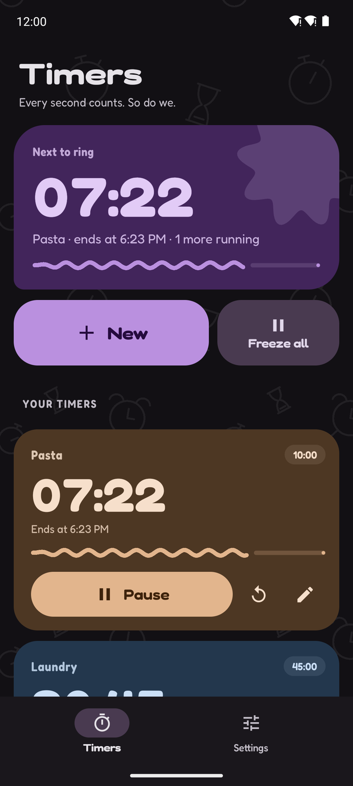
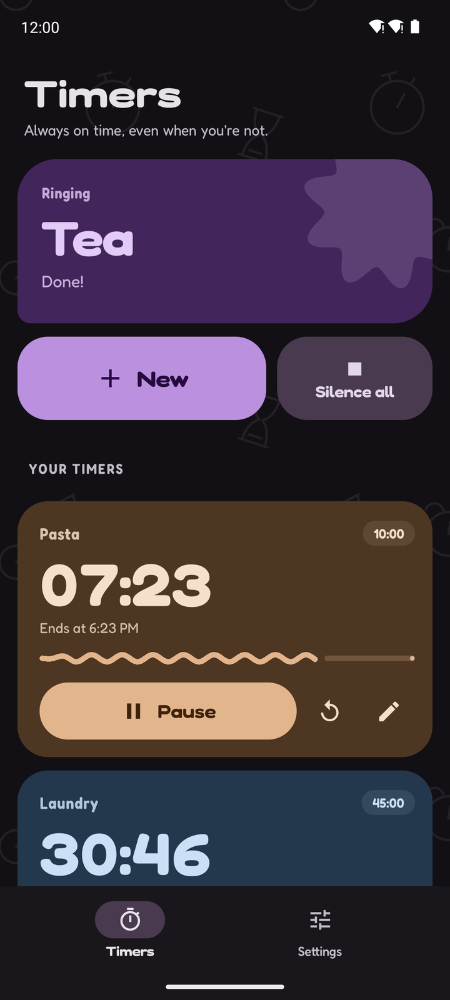
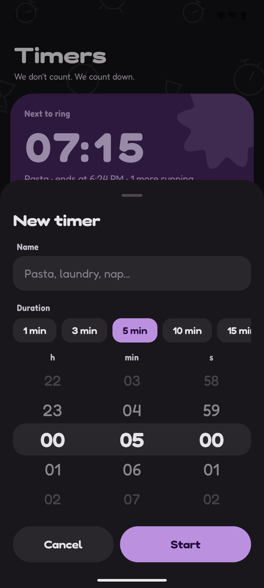
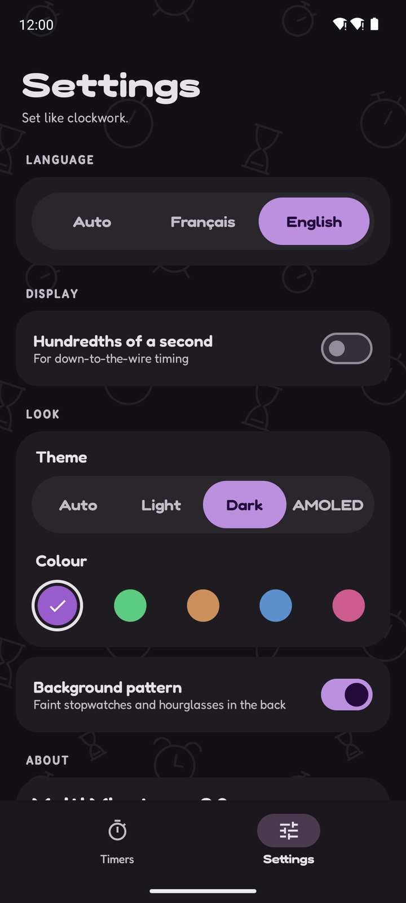
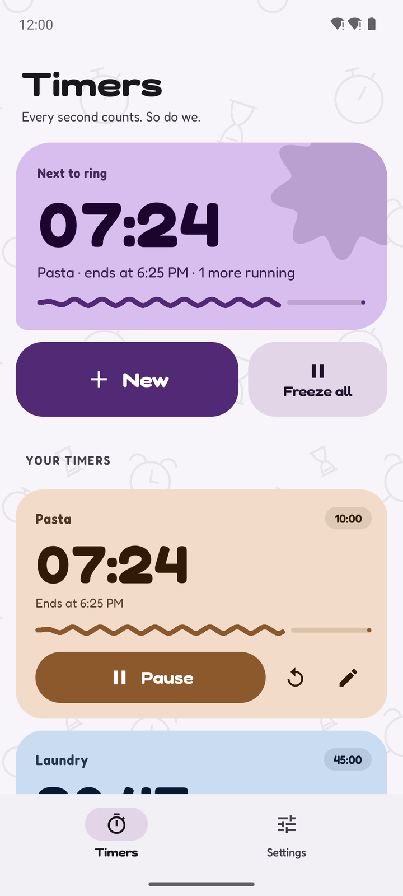

<p align="center"></p>

<h1 align="center">Multi Minuteurs</h1>

A simple Android app for running several timers at the same time.

<p align="center">
  
  
  
  
  
</p>
<p align="center"><sub>Screenshots use made-up demo data.</sub></p>

## Privacy

- **No internet permission**: the app can't send anything anywhere.
- **No ads, no tracking, no account**: timers and settings stay on the phone.

## Features

- **Run as many timers as you want** in parallel, each with its own colour card and a wavy progress bar
- Start, pause, resume, reset, edit or delete each timer on its own (tap a card to edit it)
- **Picker wheels** for hours / minutes / seconds (they loop, snap into place and give haptic feedback), plus
  quick picks from 1 min to 1 h
- With two timers or more, a summary card shows the next one to ring, or the one ringing
- Pause, resume or silence every timer in one tap
- Ongoing notification with a live countdown and a pause button
- Alarm with sound and vibration when a timer ends, even if the app is closed or the screen is locked
- Timers are saved and rescheduled after a reboot
- French and English
- Material 3 Expressive look: Fredoka font, springy buttons that squish when pressed, rolling digits, light /
  dark / AMOLED themes, 5 accent colours and a background pattern you can turn off
- Optional hundredths-of-a-second display

## Download

Get the latest signed APK from the [Releases](../../releases/latest) page.

## Build

### With GitHub Actions (no computer needed)

To publish a new release, push a tag like `v1.1` (or run the **Release** workflow by hand). It builds a signed
APK and attaches it to a GitHub release. This needs the signing secrets described below.

For quick test builds, every push to `main` builds a debug APK. Open the **Actions** tab, pick the latest run and download the
`MultiMinuteurs-debug` artifact. You can also start a build by hand with **Run workflow**.

Debug builds are signed with a throwaway key, so they won't install over a release (or over each other):
uninstall first (your timers are lost).

The release workflow needs these repository secrets (**Settings → Secrets and variables → Actions**):

| Secret | Value |
| --- | --- |
| `KEYSTORE_BASE64` | your keystore file, base64-encoded (`base64 -w0 your.keystore`) |
| `KS_PASS` | keystore and key password |
| `KS_ALIAS` | key alias |

### With Android Studio

1. **File → Open** and select this folder.
2. Let Gradle sync.
3. **Build → Build APK(s)**, or run it on a phone with USB debugging on.

Requirements: JDK 17, Android SDK 35. The minimum Android version is 8.0 (API 26).

## Permissions

| Permission | Why |
| --- | --- |
| `POST_NOTIFICATIONS` | Countdown and alarm notifications |
| `SCHEDULE_EXACT_ALARM` / `USE_EXACT_ALARM` | Ring at the exact end time |
| `RECEIVE_BOOT_COMPLETED` | Reschedule timers after a reboot |
| `VIBRATE` | Vibrate when a timer ends |

## Project layout

```
app/src/main/java/com/example/multiminuteurs/
├── MainActivity.kt   entry point
├── Ui.kt             screens: home, settings, new/edit sheet, bottom bar
├── Components.kt     buttons, segmented control, wavy progress, pattern, picker wheel, rolling digits
├── Theme.kt          colors computed from one hue, Fredoka font, light/dark/AMOLED
├── Model.kt          timer data and time formatting
├── TimerStore.kt     saving timers
├── TimerActions.kt   start / pause / edit logic and alarm scheduling
├── Notifs.kt         notification channels and notifications
├── Receivers.kt      alarm and boot receivers
└── Settings.kt       settings and FR/EN strings
```

Font: Fredoka (SIL Open Font License 1.1, see `fonts/`).
